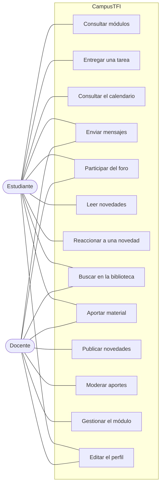
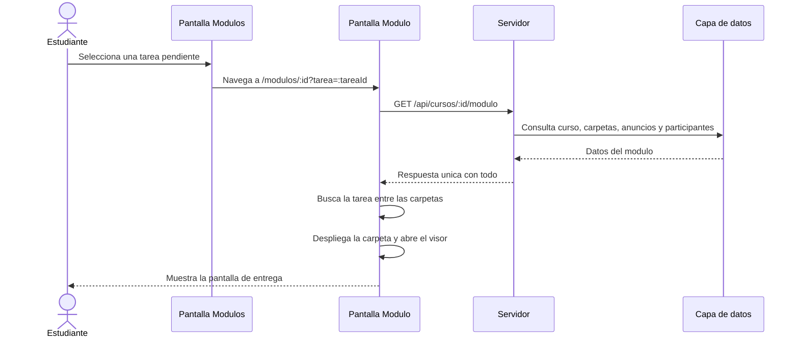
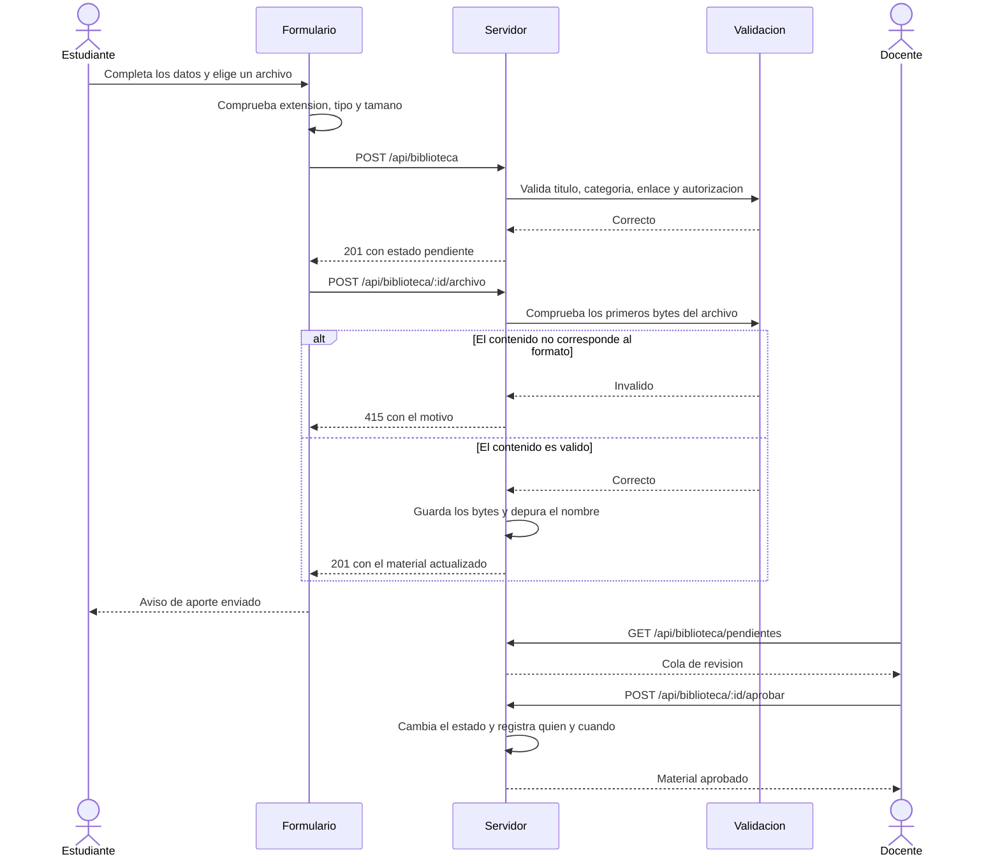
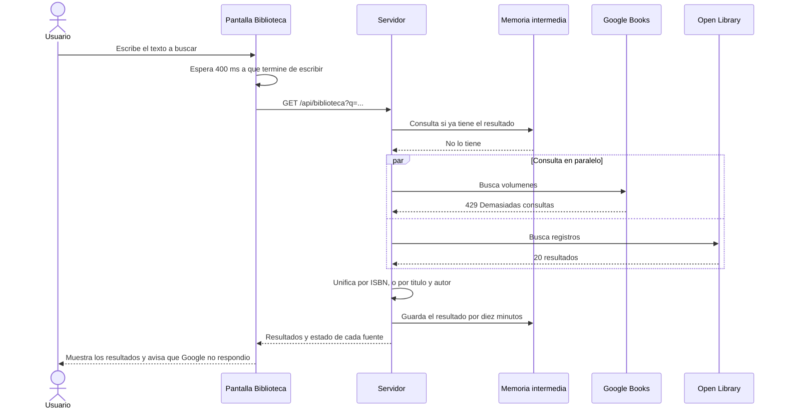
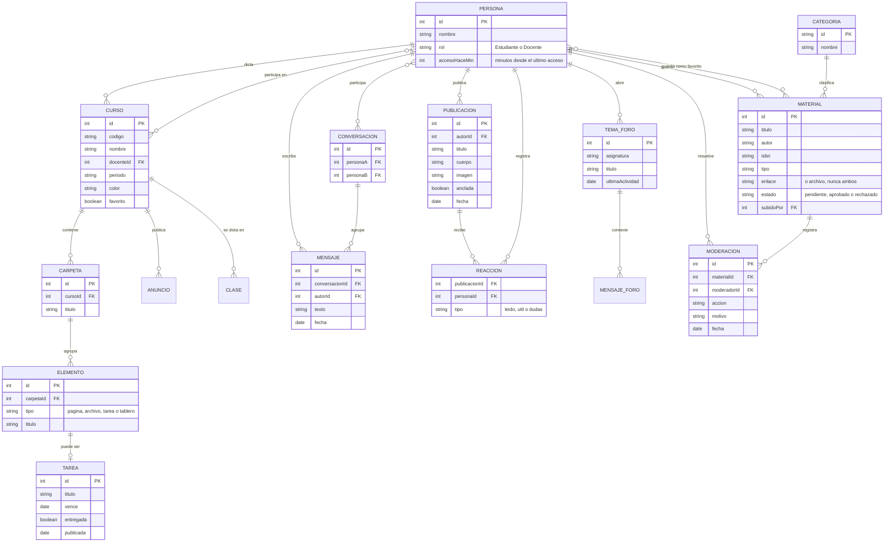
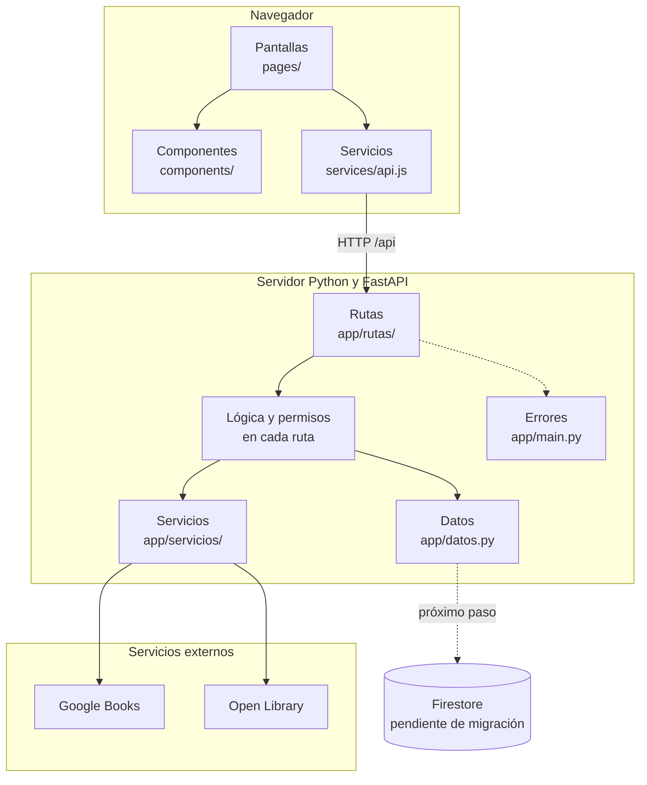

# Informe Final

> **Estado del documento:** borrador de trabajo, actualizado al 2 de noviembre de 2026.
> Los textos marcados como `[COMPLETAR]` dependen de datos que todavía no tenemos
> (nombres de los profesores, integrantes del tribunal, dedicatorias) o de capturas
> de pantalla que hay que tomar. No conviene presentarlo sin resolverlos.

---

## Carátula

**Universidad Nacional del Nordeste**
**Facultad de Ciencias Exactas y Naturales y Agrimensura**

Proyecto Final de Carrera

# "CampusTFI: campus virtual para la gestión académica"

**Alumnos:** Sosa, Santiago Rafael — Beneventano, Hernán

**Profesor Orientador:** `[COMPLETAR]`
**Profesora Coordinadora:** `[COMPLETAR]`
**Tribunal Evaluador:** `[COMPLETAR]`

Presentación Preliminar

*Licenciatura en Sistemas de Información*
*Corrientes – Argentina*
*2026*

---

## Resumen sintético

CampusTFI es un campus virtual para la gestión académica, desarrollado como Proyecto
Final de Carrera. El trabajo parte de una observación sobre las plataformas educativas
en uso: concentran mucha información, pero cuesta encontrar dónde está cada cosa y cómo
se realiza cada tarea. La propuesta aborda ese problema desde el diseño de la interfaz,
sin resignar alcance funcional.

El sistema se construyó con React y Vite en el navegador, y con Python y FastAPI del
lado del servidor. Cubre siete pantallas: Novedades, Módulos, Calendario, Foro,
Mensajes, Biblioteca y Ajustes. Incorpora además la consulta de catálogos
bibliográficos públicos mediante las interfaces de programación de Google Books y Open
Library.

---

## Resumen extendido

Las plataformas educativas que usan hoy las instituciones resuelven el problema de
distribuir contenido, pero presentan dificultades de uso. La información aparece
dispersa, las acciones frecuentes quedan a varios pasos de distancia y la presentación
visual no acompaña la lectura. El resultado es que estudiantes y docentes dedican
tiempo a entender la herramienta en lugar de dedicarlo a la materia.

CampusTFI propone una alternativa que atiende dos aspectos a la vez. El primero es la
organización: cada cosa que hay que hacer se abre en el lugar donde corresponde
hacerla. Una entrega pendiente que aparece en el panel lateral lleva a la pantalla de
entrega dentro del módulo, y no a una bandeja intermedia. El segundo aspecto es la
presentación: una paleta reducida, con significados asignados a cada color, y
transiciones que acompañan los cambios de pantalla.

El desarrollo siguió un ciclo de vida iterativo e incremental. Se organizó en cuatro
hitos de duración fija. Cada iteración incluyó análisis, diseño, implementación y
prueba de un conjunto acotado de funcionalidades. El alcance se ajustó entre
iteraciones a partir de la realimentación: la pantalla Actividad se reemplazó por un
Calendario académico, la pantalla Información pasó a ser un muro de Novedades, y se
incorporaron el Foro, la Mensajería interna y la Biblioteca.

El sistema expone 40 puntos de acceso en su interfaz de programación. La capa de datos
todavía utiliza un conjunto de datos de prueba en memoria. La migración a Firestore
está definida pero no ejecutada, y constituye la principal línea de trabajo pendiente.

---

## Prólogo

`[COMPLETAR: contexto personal en que se realizó el trabajo y las motivaciones que
llevaron a él. La cátedra pide que esta sección sea escrita por los autores.]`

## Dedicatorias

`[COMPLETAR]`

## Agradecimientos

`[COMPLETAR]`

---

## Índice general

| Sección | Contenido |
|---|---|
| Carátula | Datos institucionales y autoría |
| Resumen sintético | Síntesis del trabajo en un párrafo |
| Resumen extendido | Problema, propuesta, método y estado |
| Prólogo, Dedicatorias y Agradecimientos | Secciones personales |
| Índices | General, de figuras y de tablas |
| **1. Introducción** | Estado del arte, antecedentes, objetivos y fundamentación |
| 1.1 Breve estado del arte | Sistemas de gestión del aprendizaje y usabilidad |
| 1.2 Antecedentes | Plataformas comparadas y posición del trabajo |
| 1.3 Objetivos | Objetivo general y seis objetivos específicos |
| 1.4 Fundamentación | Justificación del problema abordado |
| **2. Metodología** | Ciclo de vida, hitos, requerimientos y casos de uso |
| 2.1 Ciclo de vida | Modelo iterativo e incremental |
| 2.2 Organización en hitos | Cuatro hitos y reparto de tareas |
| 2.3 Cumplimiento de plazos | Evidencia del historial de versiones |
| 2.4 Especificación de requerimientos | 18 funcionales y siete no funcionales |
| 2.5 Casos de uso | Actores y cursos normales y alternativos |
| 2.6 Modelo de datos | Entidades y decisiones de modelado |
| 2.7 Metodología de seguridad | Aplicación de Magerit |
| **3. Herramientas** | Tecnologías empleadas y su aplicación |
| **4. Resultados** | Sistema construido, pantalla por pantalla |
| 4.1 Arquitectura general | Organización en dos aplicaciones |
| 4.2 Arquitectura en capas | Separación de responsabilidades |
| 4.3 Criterios de diseño visual | Paleta y significado de cada color |
| 4.4 a 4.11 Pantallas | Novedades, Módulos, Calendario, Foro, Mensajes, Biblioteca y Ajustes |
| 4.12 Interfaz de programación | Los 40 puntos de acceso |
| 4.13 Pruebas realizadas | Conjunto de comprobaciones y resultados |
| 4.14 Alcance no cubierto | Funcionalidades fuera de esta entrega |
| **5. Conclusiones y líneas futuras** | Cuatro conclusiones y trece líneas |
| Referencias | Fuentes en formato IEEE |
| Anexos | Instalación, variables, repositorio, pruebas, interfaz de programación, decisiones y rúbrica |

## Índice de figuras

| Figura | Descripción | Estado |
|---|---|---|
| 1 | Arquitectura general del sistema | Incluida |
| 2 | Diagrama de casos de uso general | Incluida |
| 3 | Modelo de datos | Incluida |
| 4 | Pantalla Novedades | `[PENDIENTE: captura]` |
| 5 | Pantalla Módulos | `[PENDIENTE: captura]` |
| 6 | Pantalla interior de un módulo | `[PENDIENTE: captura]` |
| 7 | Pantalla Calendario, vista mensual | `[PENDIENTE: captura]` |
| 8 | Pantalla Foro, hilo abierto | `[PENDIENTE: captura]` |
| 9 | Pantalla Mensajes | `[PENDIENTE: captura]` |
| 10 | Pantalla Biblioteca, catálogo | `[PENDIENTE: captura]` |
| 11 | Ficha de un material de la Biblioteca | `[PENDIENTE: captura]` |
| 12 | Formulario de aporte de material | `[PENDIENTE: captura]` |
| 13 | Cola de moderación | `[PENDIENTE: captura]` |
| 14 | Secuencia: entregar una tarea | Incluida |
| 15 | Secuencia: aportar material y moderarlo | Incluida |
| 16 | Secuencia: búsqueda con una fuente caída | Incluida |

## Índice de tablas

| Tabla | Descripción |
|---|---|
| 1 | Paleta de colores y su significado |
| 2 | Requerimientos funcionales |
| 3 | Requerimientos no funcionales |
| 4 | Hitos y entregables |
| 5 | Puntos de acceso de la interfaz de programación |
| 6 | Permisos por rol en la Biblioteca |
| 7 | Resultados de las pruebas de la Biblioteca |

---

# 1. Introducción

Este trabajo presenta el desarrollo de CampusTFI, un campus virtual para la gestión
académica. El proyecto surge de la experiencia como estudiantes con las plataformas
educativas en uso y del interés por el desarrollo de aplicaciones web.

El capítulo se organiza de la siguiente manera. Primero se describe un breve estado del
arte sobre los sistemas de gestión del aprendizaje y los criterios de usabilidad que se
aplican a ellos. Luego se indican los objetivos y se expone la fundamentación del
trabajo.

## Breve estado del arte

Un sistema de gestión del aprendizaje es una aplicación que administra la distribución
de contenidos, el seguimiento de actividades y la comunicación entre docentes y
estudiantes. Moodle y Blackboard son dos de los más difundidos en el ámbito
universitario.

La literatura sobre estas plataformas identifica un problema recurrente. La cobertura
funcional es amplia, pero la arquitectura de la información dificulta el uso. Nielsen
[5] define la usabilidad a partir de cinco atributos: facilidad de aprendizaje,
eficiencia, memorabilidad, prevención de errores y satisfacción. Las plataformas
educativas tienden a resolver bien la cobertura y a rendir peor en facilidad de
aprendizaje y eficiencia.

Dos criterios de diseño resultan particularmente aplicables al caso.

El primero es la **proximidad entre la información y la acción**. Cuando el sistema
informa que existe una entrega pendiente, lo esperable es que ese aviso conduzca a la
pantalla de entrega. Las plataformas que interponen pantallas intermedias agregan pasos
sin agregar información.

El segundo es la **economía del color**. Una paleta reducida, en la que cada color tiene
un significado asignado y estable, reduce la carga de interpretación. El uso decorativo
del color produce el efecto contrario: si el rojo aparece tanto en un botón habitual
como en un aviso de atraso, deja de comunicar urgencia.

En cuanto a las tecnologías, el desarrollo web actual se apoya en bibliotecas de
componentes que mantienen sincronizados el estado de la aplicación y lo que se muestra
en pantalla. React [8] es una de ellas, y organiza la interfaz en componentes que
describen qué mostrar para un estado dado. Del lado del servidor, los marcos de trabajo
asíncronos como FastAPI [7] aprovechan que buena parte del tiempo de una consulta se
pasa esperando entrada y salida, y no calculando.

Para la persistencia, las alternativas se agrupan en dos familias. Las bases
relacionales imponen un esquema previo y garantizan integridad referencial. Las bases
de documentos, como Firestore [3], admiten esquemas flexibles y resuelven además
autenticación y almacenamiento de archivos dentro de la misma plataforma.

## Antecedentes

Antes de definir el alcance se revisaron tres plataformas en uso y los trabajos previos
del equipo sobre el tema.

**Moodle.** De código abierto y amplia adopción en el ámbito universitario
latinoamericano. Su principal fortaleza es la cobertura funcional y la extensibilidad
mediante complementos. Su principal debilidad, a los fines de este trabajo, es que la
interfaz predeterminada presenta el contenido como una lista vertical extensa, sin
jerarquía visual que distinga lo urgente de lo habitual. La personalización existe, pero
requiere conocimientos de administración.

**Blackboard.** De carácter comercial, se utiliza en varias universidades de la región.
Aporta una organización del módulo que resultó una referencia útil: pestañas para separar
contenido, anuncios y participantes, y un panel lateral con información de la materia.
Ese esquema se tomó como punto de partida para la pantalla interior de un módulo. Su
debilidad está en la densidad de la presentación y en la cantidad de pasos que requieren
las acciones frecuentes.

**Google Classroom.** Destaca por lo contrario: una interfaz despejada y de aprendizaje
inmediato. El costo de esa simplicidad es la cobertura. No resuelve calendario académico
integrado, foro por asignatura ni biblioteca, que son requisitos de este trabajo.

**Posición de este trabajo.** CampusTFI no propone superar la cobertura de Moodle ni
igualar la simplicidad de Classroom. Toma la organización por pestañas de Blackboard, el
despeje visual de Classroom y agrega dos criterios propios que no se observaron aplicados
de manera consistente en ninguna de las tres: la proximidad entre la información y la
acción, y la economía del color. La inspiración del diseño es propia; las plataformas
revisadas funcionaron como referencia y no como modelo a reproducir.

**Trabajos previos del equipo.** El proyecto retoma contenidos de las asignaturas de
desarrollo web, bases de datos e ingeniería de software de la carrera. La organización en
capas del servidor y la especificación de requerimientos siguen los criterios trabajados
en esas materias.

## Objetivos

**Objetivo general**

Desarrollar un campus virtual para la gestión académica que priorice la claridad de la
interfaz y la proximidad entre la información y la acción, para estudiantes y docentes
de una unidad académica.

**Objetivos específicos**

1. Diseñar una interfaz que permita identificar el estado de cada materia y cada
   entrega sin recorrer varias pantallas.
2. Implementar la gestión de módulos, con contenido organizado en carpetas y
   seguimiento del avance del estudiante.
3. Implementar los canales de comunicación interna: mensajería entre personas, foro de
   consultas por asignatura y muro de novedades institucionales.
4. Implementar un calendario académico que integre entregas, exámenes, clases y eventos.
5. Implementar una biblioteca que combine material propio de la institución con la
   consulta de catálogos bibliográficos públicos.
6. Definir un esquema de permisos por rol y verificarlo del lado del servidor.

## Fundamentación

Las instituciones educativas adoptaron plataformas virtuales de forma acelerada. Esa
adopción resolvió la continuidad del dictado, pero dejó pendiente la calidad de la
experiencia de uso.

El problema tiene consecuencias concretas. Un estudiante que no encuentra dónde entregar
un trabajo pierde tiempo. Un docente que necesita varios pasos para publicar un aviso
publica menos avisos. La herramienta que agrega fricción termina reemplazada por canales
informales, con la pérdida de trazabilidad que eso implica.

La comunicación es un caso claro. Las instituciones prefieren que el intercambio entre
docentes y estudiantes no ocurra en aplicaciones de mensajería personal, por razones de
privacidad y de registro. Esa preferencia se sostiene únicamente si la plataforma ofrece
un canal propio que resulte cómodo. Por ese motivo, la mensajería interna y el foro
entraron al alcance de la primera versión.

---

# 2. Metodología

## Introducción

El desarrollo comenzó con una revisión de plataformas educativas en uso y de
bibliografía sobre usabilidad. Sobre esa base se definieron el alcance y la arquitectura.

## Ciclo de vida

El ciclo de vida elegido fue **iterativo e incremental**. Según Pressman [6], el
desarrollo se organiza en una serie de proyectos cortos de duración fija llamados
iteraciones. El resultado de cada uno es un sistema que puede ser probado, integrado y
ejecutado. Cada iteración incluye sus propias actividades de análisis de requisitos,
diseño, implementación y pruebas.

La elección responde a dos condiciones del trabajo. La primera es el plazo acotado, que
desaconseja un ciclo en cascada donde los errores de definición se detectan tarde. La
segunda es que el alcance exacto no estaba cerrado al inicio: varias decisiones de
diseño surgieron al ver las pantallas funcionando.

Esa segunda condición se verificó durante el desarrollo. Tres cambios de alcance se
originaron en la realimentación entre iteraciones:

- La pantalla **Actividad**, prevista como bandeja de notificaciones, se reemplazó por
  un **Calendario académico**. La bandeja duplicaba información que ya aparecía en el
  panel de tareas pendientes.
- La pantalla **Información** pasó a ser **Novedades**, con formato de muro.
- Se incorporaron **Foro**, **Mensajes** y **Biblioteca**, que no figuraban en la
  planificación inicial.

## Organización en hitos

El trabajo se dividió en cuatro hitos, según la planificación acordada por el equipo
(Véase tabla 4).

**Tabla 4.** Hitos y entregables

| Hito | Período | Actividades | Entregable |
|---|---|---|---|
| 1. Definición y arquitectura | Días 1 a 5 | Definición de alcance y stack. Modelo de datos y puntos de acceso. Bocetos de interfaz. | Diagrama de base de datos y maquetas |
| 2. Base y cursos | Días 6 a 11 | Autenticación y roles. Gestión de cursos. Maquetación del panel y la navegación. | Navegación de cursos |
| 3. Tareas y notas | Días 12 a 16 | Lógica de entregas y calificaciones. Vistas de entregas y notas. | Módulo de asignaciones |
| 4. Pruebas y cierre | Días 17 a 21 | Corrección de errores y validaciones. Pulido de la interfaz adaptable. | Aplicación entregada |

Al momento de este informe se completaron el primer hito y la mayor parte del segundo y
el tercero, con una excepción relevante: la autenticación y los roles, previstos para el
hito 2, siguen pendientes. Esa postergación fue deliberada, y se explica en el apartado
de permisos del capítulo de resultados.

### Reparto de tareas

| Integrante | Responsabilidad |
|---|---|
| Sosa, Santiago Rafael | Interfaz de usuario y diseño visual |
| Beneventano, Hernán | Servidor, interfaz de programación y base de datos |

El equipo acordó reuniones de coordinación al menos dos veces por semana y un ritmo de
al menos un avance semanal por integrante.

## Cumplimiento de plazos

El historial del repositorio permite verificar el avance de manera objetiva. El proyecto
comenzó el 28 de octubre de 2026. Al 2 de noviembre de 2026, fecha de este informe, se
transita el día seis de los 21 previstos.

| Fecha | Aportes registrados | Hito |
|---|---|---|
| 28/10/2026 | 2 | 1. Información del equipo y planificación de hitos |
| 30/10/2026 | 1 | 1. Base del proyecto y estructura de carpetas |
| 31/10/2026 | 3 | 2. Contexto, limpieza de pantallas previas y avances |
| 01/11/2026 | 6 | 2 y 3. Calendario, Foro, Novedades y definición de Firebase |
| 02/11/2026 | 2 | 3. Rediseño visual, Ajustes, favoritos y Biblioteca |

El estado respecto de la planificación es el siguiente.

| Hito | Previsto | Estado |
|---|---|---|
| 1. Definición y arquitectura | Días 1 a 5 | Completo |
| 2. Base y cursos | Días 6 a 11 | Completo, salvo autenticación y roles |
| 3. Tareas y notas | Días 12 a 16 | Parcial. Entregas resueltas; calificaciones pendientes |
| 4. Pruebas y cierre | Días 17 a 21 | Iniciado. Pruebas de la Biblioteca ejecutadas |

El avance se encuentra adelantado respecto del cronograma: los hitos 2 y 3 estaban
previstos para los días 6 a 16 y presentan trabajo completado en el día seis. La
excepción es la autenticación, cuya postergación fue deliberada y se explica en el
capítulo de resultados.

**Comunicación del equipo.** El acuerdo establece reuniones de coordinación al menos dos
veces por semana y un avance semanal mínimo por integrante. El registro de aportes al
repositorio muestra actividad en cinco de los seis días transcurridos.

## Especificación de requerimientos

**Tabla 2.** Requerimientos funcionales

| Código | Descripción | Estado |
|---|---|---|
| RF-01 | El sistema debe listar los módulos del estudiante, agrupados por cuatrimestre. | Implementado |
| RF-02 | El sistema debe permitir marcar un módulo como favorito y recordar esa marca. | Implementado |
| RF-03 | El sistema debe mostrar el contenido de un módulo organizado en carpetas. | Implementado |
| RF-04 | El sistema debe permitir marcar un recurso como completado y mostrar el avance. | Implementado |
| RF-05 | El sistema debe listar las tareas pendientes y las atrasadas, y conducir a la entrega. | Implementado |
| RF-06 | El sistema debe mostrar un calendario con entregas, exámenes, clases y eventos. | Implementado |
| RF-07 | El sistema debe permitir filtrar el calendario por tipo de evento. | Implementado |
| RF-08 | El sistema debe permitir el intercambio de mensajes entre personas del campus. | Implementado |
| RF-09 | El sistema debe limitar la búsqueda de destinatarios a quienes comparten un módulo. | Implementado |
| RF-10 | El sistema debe permitir abrir temas de consulta y responderlos, por asignatura. | Implementado |
| RF-11 | El sistema debe mostrar un muro de novedades con reacciones anónimas. | Implementado |
| RF-12 | El sistema debe restringir la publicación de novedades a los docentes. | Implementado |
| RF-13 | El sistema debe permitir buscar libros en catálogos bibliográficos públicos. | Implementado |
| RF-14 | El sistema debe permitir aportar material a la biblioteca institucional. | Implementado |
| RF-15 | El sistema debe someter los aportes a moderación antes de publicarlos. | Implementado |
| RF-16 | El sistema debe permitir editar los datos del perfil propio. | Implementado |
| RF-17 | El sistema debe permitir el inicio de sesión con usuario y contraseña. | **Pendiente** |
| RF-18 | El sistema debe permitir calificar una entrega con nota y comentario. | **Pendiente** |

**Tabla 3.** Requerimientos no funcionales

| Código | Descripción | Estado |
|---|---|---|
| RNF-01 | La interfaz debe desarrollarse en JavaScript y el servidor en Python. | Cumplido |
| RNF-02 | La interfaz debe adaptarse a computadoras, tabletas y teléfonos. | Cumplido |
| RNF-03 | El texto debe alcanzar la relación de contraste mínima sobre su fondo. | Cumplido |
| RNF-04 | Las comprobaciones de permisos deben realizarse en el servidor. | Cumplido |
| RNF-05 | La interfaz debe estar íntegramente en español. | Cumplido |
| RNF-06 | Las animaciones deben reducirse si el sistema operativo lo solicita. | Cumplido |
| RNF-07 | La aplicación debe seguir operando si un servicio externo no responde. | Cumplido |

## Casos de uso

**Figura 2.** Diagrama de casos de uso general



El docente dispone de los casos de uso del estudiante y agrega los de publicación,
moderación y gestión del módulo. El rol de Administrador no se representa porque
todavía no existe en el sistema: sus funciones las ejerce el Docente, según se explica
en el capítulo de resultados.

Los actores del sistema son tres: **Estudiante**, **Docente** y **Administrador**. El
tercero está definido en el modelo de permisos pero todavía no existe como rol en los
datos, por lo que sus funciones las ejerce el Docente. Esta decisión se detalla en el
capítulo de resultados.

### Caso de uso: Entregar una tarea

**Actor:** Estudiante

| Acción | Curso normal | Curso alternativo |
|---|---|---|
| 1. Selecciona una tarea del panel de pendientes | 1.1. El sistema abre el módulo que contiene la tarea.<br>1.2. Despliega la carpeta correspondiente y abre el visor de entrega. | 1.1. Si la tarea no se encuentra en ninguna carpeta, el sistema abre el módulo sin desplegar nada. |
| 2. Adjunta el archivo y confirma | 2.1. El sistema registra la entrega y actualiza el avance de la carpeta. | 2.1. Si falta el archivo, muestra el motivo y mantiene el formulario abierto. |

### Caso de uso: Aportar material a la biblioteca

**Actor:** Estudiante o Docente

| Acción | Curso normal | Curso alternativo |
|---|---|---|
| 1. Selecciona "Aportar material" | 1.1. El sistema muestra el formulario. | |
| 2. Completa los datos y confirma la autorización | 2.1. El sistema valida los campos obligatorios.<br>2.2. Valida el tipo y el tamaño del archivo. | 2.1. Si falta el título, indica el campo faltante.<br>2.2. Si no se confirma la autorización, rechaza el aporte. |
| 3. Envía | 3.1. El aporte queda en estado pendiente y aparece en "Mis aportes".<br>3.2. Si lo envía quien modera, se publica de inmediato. | 3.1. Si el archivo no corresponde al tipo declarado, lo rechaza e informa el motivo. |

### Caso de uso: Moderar un aporte

**Actor:** Docente

| Acción | Curso normal | Curso alternativo |
|---|---|---|
| 1. Abre la pestaña Revisión | 1.1. El sistema lista los aportes pendientes. | 1.1. Si no hay aportes pendientes, lo indica. |
| 2. Selecciona Aprobar | 2.1. El material pasa a estado aprobado y aparece en el catálogo.<br>2.2. Se registra quién aprobó y cuándo. | |
| 3. Selecciona Rechazar | 3.1. El sistema solicita el motivo.<br>3.2. Registra el rechazo y lo muestra a quien aportó. | 3.1. Si no se indica un motivo, no permite completar la acción. |


## Diagramas de secuencia

**Figura 14.** Entregar una tarea desde el panel de pendientes



La consulta al servidor es una sola. Resolverla con cuatro consultas separadas
multiplicaba los estados intermedios de carga en la pantalla.

**Figura 15.** Aportar material a la biblioteca y moderarlo



**Figura 16.** Búsqueda en catálogos externos con una fuente caída



La caída de una fuente no interrumpe la búsqueda. El campo que informa el estado de cada
catálogo permite que la pantalla lo comunique en lugar de presentar una lista vacía sin
explicación.

## Modelo de datos

**Figura 3.** Modelo de datos



Dos relaciones conviene señalar. Una persona se vincula con un curso de dos maneras
distintas: como docente a cargo o como participante. Y un material se relaciona con
varias entradas de moderación, porque un aporte rechazado puede corregirse y volver a
revisión, de modo que el historial conserva cada resolución.

Las entidades principales son las siguientes.

| Entidad | Contenido |
|---|---|
| Persona | Identificador, nombre, rol y último acceso |
| Curso | Código, nombre, docente a cargo, período, color y marca de favorito |
| Carpeta | Título y elementos de contenido de un curso |
| Tarea | Título, fecha límite, estado de entrega y fecha de publicación |
| Conversación | Las dos personas que participan y sus mensajes |
| Tema de foro | Asignatura, título y lista de mensajes |
| Publicación | Autor, ámbito, categoría, cuerpo, imagen y reacciones |
| Material | Datos bibliográficos, archivo o enlace, autor del aporte y estado de moderación |

Dos decisiones de modelado conviene señalar.

La primera es que las personas se almacenan una sola vez, en una lista única, y el resto
de las entidades las referencia por su identificador. La alternativa, repetir nombre y
rol en cada lugar, obliga a actualizar varios registros ante un solo cambio.

La segunda es que las personas guardan los minutos transcurridos desde su último acceso
y no una fecha fija. El estado de presencia se calcula en cada consulta. De ese modo los
estados mantienen su sentido aunque el servidor lleve horas en ejecución.

## Metodología de seguridad

Para el tratamiento de los riesgos se tomó como referencia la metodología Magerit [4].
Se aplicaron los siguientes pasos.

1. **Determinar los riesgos del desarrollo.** El riesgo principal es la pérdida del
   trabajo realizado. Un riesgo secundario es la indisponibilidad de un integrante
   durante el plazo acotado del proyecto.
2. **Determinar las amenazas.** Pérdida de datos locales, exposición de credenciales en
   el repositorio y carga de archivos maliciosos por parte de los usuarios.
3. **Determinar las salvaguardas.** El código se versiona con Git y se publica en un
   repositorio remoto compartido. Las credenciales de Firebase se mantienen en archivos
   de entorno excluidos del control de versiones. Los archivos que se suben a la
   biblioteca se validan por su contenido y no por su extensión.
4. **Estimar el impacto.** La pérdida del repositorio interrumpiría el desarrollo. La
   exposición de credenciales obligaría a revocarlas y regenerarlas.
5. **Estimar el riesgo.** El riesgo de pérdida de código es bajo, por el versionado
   distribuido. El riesgo de carga maliciosa es moderado y se atiende con las
   validaciones descritas en el capítulo de resultados.

---

# 3. Herramientas

La selección respondió a dos criterios: el uso de un mismo lenguaje en el navegador y en
el servidor, para reducir el costo de cambiar de contexto, y la disponibilidad de
documentación y ejemplos accesibles.

## JavaScript

JavaScript es un lenguaje de programación interpretado, basado en el estándar
ECMAScript. Se define como orientado a objetos, basado en prototipos, imperativo,
débilmente tipado y dinámico.

**Aplicación en el proyecto.** Es el lenguaje de la interfaz. El navegador ejecuta
JavaScript y WebAssembly, y nada más, de modo que para la parte que corre en el
navegador no hay alternativa.

## React

React [8] es una biblioteca para construir interfaces de usuario a partir de
componentes. Un componente describe qué mostrar para un estado dado, y la biblioteca se
ocupa de actualizar la pantalla cuando ese estado cambia.

**Aplicación en el proyecto.** La interfaz se compone de 15 componentes reutilizables y
nueve pantallas. Entre los componentes se encuentran el menú lateral, las tarjetas de
módulo, el visor de elementos y el desplegable propio que reemplaza al selector del
navegador.

## Vite

Vite es una herramienta de construcción para aplicaciones web. Durante el desarrollo
sirve los archivos sin empaquetarlos previamente, lo que reduce el tiempo de arranque.

**Aplicación en el proyecto.** Provee el servidor de desarrollo y redirige las consultas
dirigidas a `/api` hacia el servidor, lo que evita configurar el intercambio
de recursos entre orígenes durante el desarrollo.

## React Router

React Router asocia direcciones a componentes. Permite que la aplicación cambie de
pantalla sin recargar la página.

**Aplicación en el proyecto.** Administra las rutas de las siete pantallas principales y
la ruta con parámetro que abre un módulo determinado.

## Python

Python es un lenguaje interpretado, de tipado dinámico y sintaxis orientada a la
legibilidad. Desde la versión 3.5 incorpora `async` y `await`, que permiten escribir
código asíncrono sin recurrir a cadenas de funciones de retorno.

**Aplicación en el proyecto.** Es el lenguaje del servidor. Se eligió por el dominio
previo del equipo y por la disponibilidad de bibliotecas para las tareas pendientes,
entre ellas el kit de desarrollo de Firebase para administradores.

## FastAPI

FastAPI [7] es un marco de trabajo para construir interfaces de programación en Python.
Se apoya en las anotaciones de tipo del lenguaje para validar los datos de entrada y
generar la documentación. Es asíncrono de origen, sobre la especificación ASGI.

**Aplicación en el proyecto.** Estructura los 40 puntos de acceso. Tres características
resultaron determinantes para este caso.

La primera es el carácter asíncrono. La Biblioteca consulta dos catálogos externos en
cada búsqueda, y `asyncio.gather` permite lanzarlos en paralelo: el tiempo total es el
de la fuente más lenta y no la suma de ambas.

La segunda es la generación automática de la documentación. FastAPI publica la
especificación OpenAPI en `/docs` a partir del propio código, de modo que no puede
quedar desactualizada respecto de lo que el servidor hace.

La tercera es el tratamiento de errores. Un gestor propio convierte las excepciones en
respuestas con la forma `{ error: "motivo" }`, que es la que espera la interfaz.

## Uvicorn

Uvicorn es el servidor ASGI que ejecuta la aplicación. Se encarga del protocolo HTTP y
del bucle de eventos.

**Aplicación en el proyecto.** Levanta el servidor durante el desarrollo y lo reinicia
al guardar un archivo.

## httpx

httpx es un cliente HTTP para Python con soporte asíncrono.

**Aplicación en el proyecto.** Realiza las consultas a Google Books y Open Library. Se
le indica de forma explícita que verifique los certificados contra el almacén del
sistema operativo y no contra el paquete que trae la biblioteca, por los motivos que se
detallan en el capítulo de resultados.

## Firebase

Firebase [3] es una plataforma que reúne base de datos de documentos, autenticación y
almacenamiento de archivos.

**Aplicación en el proyecto.** Está decidida como base de datos del sistema y
configurada en el código de la interfaz. La migración de los datos todavía no se
realizó. Firebase Authentication resolverá el inicio de sesión y Firebase Storage el
almacenamiento de archivos.

## Interfaces de programación de catálogos bibliográficos

La Biblioteca consulta dos servicios públicos.

**Google Books** [2] expone datos bibliográficos y, cuando corresponde, enlaces de
lectura o de descarga. Admite consultas acotadas por título, autor, número internacional
normalizado del libro o materia.

**Open Library** [1] cumple una función complementaria. Aporta registros que Google
Books no devuelve y señala qué obras admiten préstamo digital.

**Aplicación en el proyecto.** Las dos se consultan desde el servidor y no desde el
navegador. Esa decisión responde a tres motivos: la clave de acceso no viaja al
navegador, la memoria intermedia de resultados se comparte entre usuarios, y si un
servicio no responde la pantalla continúa operando con el otro.

## Git y GitHub

Git es un sistema de control de versiones distribuido. Cada integrante dispone de una
copia completa del historial y los cambios se propagan entre repositorios.

**Aplicación en el proyecto.** Registra la evolución del código. El repositorio remoto
está alojado en GitHub y permite el trabajo simultáneo de los dos integrantes.

## Herramientas de verificación

Para comprobar el comportamiento de la interfaz se empleó un navegador Chromium en modo
sin ventana, controlado por programa. Permite cargar una pantalla, consultar qué se
dibujó, simular la interacción y tomar capturas.

**Aplicación en el proyecto.** Se utilizó para verificar cada pantalla antes de darla
por terminada, en lugar de confiar en la inspección visual. Los resultados se detallan
en el capítulo siguiente.

---

# 4. Resultados

## Arquitectura general

**Figura 1.** Arquitectura general del sistema



La línea punteada hacia Firestore señala el reemplazo previsto de la capa de datos. Por
estar la responsabilidad aislada en esa capa, el cambio no alcanza a las rutas ni a la
interfaz.

El sistema se organiza en dos aplicaciones.

La **interfaz** se ejecuta en el navegador. Contiene las pantallas, los componentes y
una capa de servicios que concentra las consultas al servidor en un único archivo.

El **servidor** se ejecuta sobre Python. Se organiza en rutas, que asocian direcciones
a funciones y contienen la lógica y la verificación de permisos; servicios, para lo que
no pertenece a una sola ruta; y una capa de datos que hoy corresponde a un conjunto de
datos de prueba en memoria.

La separación tiene un propósito concreto. Cuando se realice la migración a Firestore,
solo cambia la capa de datos. Las rutas y la interfaz permanecen iguales.

En números, el sistema reúne alrededor de 13.900 líneas: 5.672 de código de interfaz,
5.393 de hojas de estilo y 2.870 de código de servidor.

## Arquitectura en capas

El servidor separa responsabilidades en cuatro capas. Cada una conoce únicamente a la
siguiente, de modo que un cambio en la capa de datos no obliga a modificar las rutas.

| Capa | Ubicación | Responsabilidad |
|---|---|---|
| Rutas | `backend/app/rutas/` | Asociar una dirección y un método a una función, validar la entrada, verificar permisos y dar forma a la respuesta. |
| Servicios | `backend/app/servicios/` | Lógica que no pertenece a una única ruta. Hoy contiene la consulta de catálogos externos. |
| Datos | `backend/app/datos.py` | Acceso al almacenamiento. Hoy es un conjunto de datos en memoria; mañana será Firestore. |
| Errores | `backend/app/main.py` | Gestores que convierten cualquier excepción en una respuesta con la forma que espera la interfaz. |

La preparación de la respuesta cumple la función de un serializador. Las funciones
`_con_datos` y `_con_autor`, en las rutas de Biblioteca y Novedades, construyen el
objeto que se envía al navegador y deciden qué campos quedan fuera. El caso más claro es
el de las reacciones: la estructura interna guarda los identificadores de quienes
reaccionaron, y el serializador los reemplaza por totales antes de responder. La
anonimidad no depende de que el navegador omita mostrar un dato, sino de que ese dato
nunca salga del servidor.

En la interfaz la separación es equivalente. Las pantallas, en `pages/`, resuelven la
disposición y el estado. Los componentes, en `components/`, son piezas reutilizables sin
conocimiento del contexto en el que se usan. Los servicios, en `services/`, concentran
todas las consultas al servidor en un único archivo, de modo que ninguna pantalla
construye direcciones por su cuenta.

**Comunicación entre partes alejadas.** Algunos componentes mantienen su propia copia de
los datos y la obtienen una sola vez, al iniciarse. El menú lateral es el caso típico.
Para que se entere de un cambio producido en otra pantalla, la capa de servicios emite un
aviso al que el componente se suscribe. Ese mecanismo resuelve, por ejemplo, que al
marcar un módulo como favorito en la pantalla Módulos la estrella aparezca de inmediato
en el menú.

## Criterios de diseño visual

La paleta se define mediante variables en un único bloque del archivo de estilos. Las
variables se nombran por su función y no por su color, de modo que probar otra paleta
requiere modificar un solo bloque.

**Tabla 1.** Paleta de colores y su significado

| Variable | Color | Significado |
|---|---|---|
| `--oscuro` | `#0C101F` | Menú lateral y títulos |
| `--principal` | `#42A5F5` | Color de acento: botones y elementos activos |
| `--gris` | `#8D99AE` | Bordes y detalles |
| `--panel` | `#EDF2F4` | Recuadros y paneles |
| `--fondo` | `#F8FAFB` | Fondo de la página |
| `--alerta` | `#D80032` | Atrasos, errores y avisos sin leer |
| `--progreso-medio` | `#D9A21B` | Avance entre 40 y 79 por ciento |
| `--progreso-alto` | `#2F8F5B` | Avance desde 80 por ciento |

El rojo cumple dos funciones y ninguna más: señalar lo que está mal y señalar lo que
está sin leer. El resto de los acentos emplea el azul. Esta restricción sostiene el
criterio de economía del color expuesto en el estado del arte.

El amarillo y el verde aparecen en un solo lugar: las barras de avance. Allí funcionan
como un semáforo y no como identidad visual.

El texto secundario utiliza una versión oscurecida del gris. El gris puro no alcanza la
relación de contraste mínima sobre los paneles claros.

## Pantalla Novedades

`[PENDIENTE: captura — Véase figura 4]`

Es la pantalla de inicio. Presenta un muro con formato de red social. Cada publicación
indica autor, antigüedad, ámbito, categoría, título y texto.

En la parte superior se ubica una portada con un carrusel de las tres novedades más
relevantes. La primera es la destacada, y solo puede haber una por vez: al destacar otra,
el servidor retira la marca de la anterior.

Debajo se presenta la lista completa en un mosaico de tres columnas de altura variable.
Los textos extensos se recortan a 170 caracteres, con un botón que abre la publicación
completa superpuesta sobre la pantalla.

La apertura de esa vista emplea la técnica FLIP: se mide la posición inicial y la final,
se aplica una transformación que simula el estado inicial y luego se retira, de modo que
el navegador anime la diferencia. El resultado es que la publicación parece desplazarse
desde su tarjeta hacia el centro.

**Reacciones.** Cada novedad admite tres reacciones: "Lo leí", "Me sirve" y "Me genera
dudas". Cada persona registra una sola. Las reacciones son anónimas: el servidor
almacena los identificadores de quienes reaccionaron, pero nunca los incluye en la
respuesta. Devuelve los totales y la reacción propia de quien consulta.

**Permisos.** Publicar y editar corresponde a los docentes, y editar solo la propia
publicación. La verificación se realiza en el servidor, que responde con el código 403
cuando no corresponde.

## Pantalla Módulos

`[PENDIENTE: captura — Véase figura 5]`

Lista las materias separadas por cuatrimestre, con los períodos más recientes arriba.
Dentro de cada grupo, los favoritos aparecen primero, señalados con una estrella.

La barra superior ofrece el cambio entre vista de tarjetas y vista de lista, un buscador
y filtros por fecha y por favoritos. Al cambiar de vista, cada módulo reproduce su
animación de entrada de forma escalonada.

Los módulos con novedades llevan un reflejo que los cruza cada tanto. El movimiento es
breve y luego espera: un movimiento constante resulta molesto.

El panel derecho presenta las tareas pendientes recientes y las atrasadas. Cada tarea
muestra la materia, el título, el vencimiento y un contador que indica cuánto lleva
realizado el estudiante en la carpeta donde vive esa tarea. Las atrasadas se distinguen
por un ícono de reloj y por la negrita, no por el tono.

Cada tarea conduce a la pantalla de entrega dentro del módulo. El identificador de la
tarea queda registrado en la dirección, de modo que el enlace sirve para compartir o
para recargar.

## Pantalla interior de un módulo

`[PENDIENTE: captura — Véase figura 6]`

Presenta el encabezado con código, nombre, docente y período; las pestañas de Contenido,
Anuncios, Participantes y Notas; y el cuerpo en dos columnas.

En Contenido se muestran las carpetas, que se abren y cierran con sus elementos dentro.
Cada recurso lleva una casilla para marcarlo como completado. Las tareas no la llevan,
porque se completan al entregarlas.

La cabecera de cada carpeta indica cuántos elementos se completaron y presenta una barra
de avance. El texto del avance toma el color de la barra. Mientras falta material lleva
un triángulo de advertencia; al alcanzar el verde pasa a una marca de verificación.

Las carpetas animan su altura mediante la transición de las filas de una cuadrícula, lo
que evita tener que medirla. Los elementos permanecen montados y se retiran del recorrido
por teclado mientras la carpeta está cerrada.

## Pantalla Calendario

`[PENDIENTE: captura — Véase figura 7]`

Presenta cuatro tipos de elementos, distinguidos por el color del borde izquierdo:
entregas, exámenes, clases y eventos de la facultad. Las entregas son enlaces y
conducen a la pantalla de entrega del módulo.

Ofrece dos vistas, mensual y semanal, con desplazamiento entre períodos y un botón para
volver al día actual. La cuadrícula es siempre de siete columnas. En la vista mensual
comienza el lunes de la semana del día primero, de modo que se ven días del mes vecino,
atenuados.

Los filtros permiten elegir qué tipos mostrar, e indican cuántos elementos hay de cada
uno. No se pueden desactivar los cuatro a la vez, porque dejaría la cuadrícula vacía sin
motivo. La elección se recuerda entre visitas.

Las clases son semanales. Se almacenan el día y el horario, y el servidor las expande a
las fechas del rango consultado.

## Pantalla Foro

`[PENDIENTE: captura — Véase figura 8]`

Lista los temas desde la última actividad hacia atrás, con filtros por asignatura y un
buscador. Al abrir un tema se presentan la consulta y sus respuestas, con la caja de
escritura ubicada arriba.

El tema y sus respuestas constituyen una única lista de mensajes. El primero es el que
abre el tema. Los temas admiten votos y seguimiento.

## Pantalla Mensajes

`[PENDIENTE: captura — Véase figura 9]`

Presenta las conversaciones a la izquierda y el hilo abierto a la derecha. Son
conversaciones entre dos personas.

El buscador filtra las conversaciones existentes y, debajo, muestra personas de los
módulos propios con quienes todavía no se conversó. La búsqueda no alcanza a todo el
campus: el servidor devuelve únicamente a quienes comparten un módulo con quien consulta.

Desde los participantes de un módulo, un ícono conduce a la conversación con esa persona
y la crea si no existía.

La caja de escritura admite hasta cinco archivos adjuntos, que se presentan como fichas
antes de enviarse. De los adjuntos se conserva el nombre y el tamaño. El almacenamiento
efectivo del archivo queda sujeto a la incorporación de Firebase Storage.

## Pantalla Biblioteca

`[PENDIENTE: capturas — Véanse figuras 10, 11, 12 y 13]`

Combina dos fuentes de contenido que se distinguen visualmente: los materiales de la
institución y los libros de catálogos externos.

La pantalla ofrece cuatro secciones: Catálogo, Guardados, Mis aportes y, para quienes
moderan, Revisión con su contador de pendientes.

### Consulta de catálogos externos

Las dos interfaces de programación se consultan en paralelo. Las respuestas se
normalizan a una misma estructura y se unifican por número internacional normalizado
del libro. Cuando ese dato falta, la unificación se realiza por título y autor
normalizados, sin tildes ni signos.

Cuando una obra aparece en ambos catálogos se conserva el registro de Google Books, que
con mayor frecuencia aporta descripción y portada, se completan los campos faltantes con
el de Open Library y se indica la segunda fuente.

Un criterio gobierna la presentación de las acciones: **solo se muestran las opciones que
la fuente ofrece efectivamente**. El botón de descarga aparece únicamente si la interfaz
de programación informa que la obra pertenece al dominio público. El préstamo aparece
únicamente si Open Library lo señala como disponible. Cuando no hay ninguna opción, la
ficha lo indica en lugar de presentar un botón sin función.

El sistema mantiene una memoria intermedia de diez minutos, un tiempo máximo de espera
de nueve segundos por fuente y un límite de treinta búsquedas por minuto. Si un servicio
no responde, la respuesta informa el estado de cada fuente y la pantalla lo comunica
sobre los resultados.

### Aporte de materiales

El formulario solicita los datos bibliográficos, la carrera, la materia, el idioma y el
archivo o el enlace a la fuente original. Incluye una confirmación obligatoria de que
quien aporta dispone de autorización para compartir el material.

Cada material conserva **un enlace o un archivo, nunca ambos**. Cuando la institución no
dispone de derechos para alojar la obra, se registra el enlace a la fuente legítima.

### Validación de archivos

Se aceptan archivos en formato PDF y EPUB, con un tamaño máximo configurable de 15
megabytes. La validación se realiza en el servidor y comprende cinco comprobaciones:

1. La extensión corresponde a un formato admitido.
2. El tipo declarado por el navegador coincide con la extensión.
3. El contenido corresponde efectivamente al formato declarado. Se verifican los primeros
   bytes del archivo. La extensión por sí sola no prueba nada, dado que cualquier archivo
   puede renombrarse.
4. El archivo no está vacío ni supera el tamaño máximo.
5. El nombre se depura antes de utilizarse, de modo que un nombre con rutas relativas no
   pueda escribir fuera del lugar previsto.

La descarga se entrega siempre como archivo adjunto y con la indicación de no inferir el
tipo, de manera que un archivo de otra persona no se ejecute dentro del campus.

### Permisos y moderación

**Tabla 6.** Permisos por rol en la Biblioteca

| Acción | Estudiante | Docente |
|---|---|---|
| Consultar el catálogo | Sí | Sí |
| Descargar material aprobado | Sí | Sí |
| Guardar en favoritos | Sí | Sí |
| Aportar material | Sí, queda pendiente | Sí, se publica directamente |
| Ver un material pendiente | Solo el propio | Sí |
| Editar o retirar un material | Solo el propio | Cualquiera |
| Aprobar o rechazar aportes | No | Sí |

El rechazo requiere indicar un motivo. Sin esa indicación, quien aportó no dispone de
información para corregir. El motivo se registra junto con el responsable y la fecha, y
se muestra en la sección de aportes propios.

**Sobre el rol de Administrador.** El modelo de permisos contempla tres roles, pero la
lista de personas del sistema contiene únicamente Estudiante y Docente. Hasta que exista
el rol de Administrador, la moderación la ejerce el Docente, que es quien responde por el
material de su cátedra. La decisión se concentró en una única función del controlador, de
modo que incorporar el rol requiera modificar un solo punto del código.

## Pantalla Ajustes

Presenta el perfil de la persona: avatar, nombre, apellido y correo, junto con el rol y
el último acceso, que se muestran pero no se editan porque los define la institución.

## Menú lateral

El menú se ubica contra el borde izquierdo y ocupa todo el alto. Puede plegarse, en cuyo
caso quedan únicamente los íconos. La preferencia se recuerda entre visitas.

Al ingresar a un módulo se pliega automáticamente, para ceder espacio al contenido. Al
salir recupera la preferencia del usuario. El plegado automático es el único que no
sobrescribe esa preferencia.

La opción Módulos se despliega y lista las materias separadas por cuatrimestre, lo que
permite saltar de una a otra sin pasar por la grilla.

Cada apartado muestra la cantidad de elementos nuevos en un círculo. Los números se
consultan al cambiar de pantalla, de modo que al salir de Mensajes el contador refleje lo
que se acaba de leer.

**Presencia.** Cada persona muestra su estado mediante un punto de color: conectado,
ausente o desconectado. El estado de quien navega se calcula a partir de su actividad en
la página: ausente tras cinco minutos sin interacción, desconectado al cambiar de
pestaña. El de las demás personas lo calcula el servidor con los mismos cortes.

## Interfaz de programación

**Tabla 5.** Puntos de acceso de la interfaz de programación

| Recurso | Operaciones |
|---|---|
| General | `GET /api/salud`, `GET /api/me`, `PUT /api/me`, `GET /api/contadores` |
| Cursos | `GET /api/cursos`, `GET /api/cursos/:id`, `GET /api/cursos/:id/modulo`, `POST /api/cursos/:id/favorito` |
| Tareas | `GET /api/tareas/pendientes` |
| Mensajes | `GET /api/mensajes`, `POST /api/mensajes`, `GET /api/mensajes/contactos`, `GET /api/mensajes/:id`, `POST /api/mensajes/:id` |
| Novedades | `GET /api/novedades`, `POST /api/novedades`, `PUT /api/novedades/:id`, `POST /api/novedades/:id/reaccion` |
| Calendario | `GET /api/calendario` |
| Foro | `GET /api/foro`, `POST /api/foro`, `GET /api/foro/:id`, `POST /api/foro/:id`, `POST /api/foro/:id/seguir`, `POST /api/foro/:id/mensajes/:mensajeId/voto` |
| Biblioteca | 15 operaciones de consulta, aporte, moderación, archivos y favoritos |

La pantalla de un módulo se resuelve con una única consulta que devuelve el curso, las
carpetas, los anuncios y los participantes. La alternativa, cuatro consultas separadas,
multiplicaba los estados intermedios de carga.

## Pruebas realizadas

Las pruebas se concentraron en la Biblioteca, por ser el componente con mayor superficie
de riesgo: recibe archivos de los usuarios, consulta servicios externos y aplica un
esquema de permisos.

Se desarrolló un conjunto de 41 comprobaciones automatizadas sobre el servidor en
ejecución. Reside en `backend/pruebas/biblioteca.py` y se ejecuta con
`python -m pruebas.biblioteca`. La totalidad se ejecuta con resultado favorable.

Las comprobaciones se realizan contra el servidor en marcha y no sobre funciones
aisladas. El motivo es que lo que interesa verificar es el camino completo: la ruta, los
permisos, la validación y la respuesta. Un archivo que el controlador rechaza pero que
la ruta nunca le entrega no prueba nada sobre el comportamiento real del sistema.

**Tabla 7.** Resultados de las pruebas de la Biblioteca

| Grupo | Comprobaciones | Resultado |
|---|---|---|
| Permisos del estudiante | 3 | Favorable |
| Validación de aportes | 5 | Favorable |
| Creación de un aporte | 2 | Favorable |
| Validación de archivos | 8 | Favorable |
| Descarga y encabezados | 5 | Favorable |
| Visibilidad de lo pendiente | 2 | Favorable |
| Acceso a material ajeno | 5 | Favorable |
| Favoritos | 6 | Favorable |
| Búsqueda y filtros | 5 | Favorable |
| Limpieza y baja | 2 | Favorable |
| **Total** | **41** | **41 correctas** |

Entre las comprobaciones de seguridad conviene destacar cuatro resultados.

- Un archivo ejecutable renombrado con extensión PDF se rechaza con el código 415, dado
  que la validación inspecciona el contenido.
- Un archivo con nombre `../../../etc/passwd` se almacena como `passwd.pdf`.
- La consulta de un material pendiente ajeno responde con el código 403, tanto para la
  ficha como para el archivo.
- La aprobación de un aporte por parte de un estudiante responde con el código 403.

La moderación se verificó por separado, modificando temporalmente el usuario de prueba
al rol de Docente. Se comprobaron el acceso a la cola, el rechazo con motivo obligatorio,
la aprobación y el registro en el historial.

Las pantallas se verificaron con el navegador controlado por programa. Para la Biblioteca
se comprobaron la carga del catálogo, la búsqueda con resultados externos, el circuito
completo de aporte con un archivo real, la descarga del archivo almacenado, la cola de
moderación y la presentación a 390 píxeles de ancho, sin desplazamiento horizontal.

**Degradación ante la caída de un servicio.** Durante las pruebas, Google Books respondió
con el código 429, que indica exceso de consultas desde una misma dirección. La situación
permitió verificar el comportamiento previsto: la pantalla informó que esa fuente no
respondió y presentó los veinte resultados obtenidos de Open Library.

## Alcance no cubierto

Por transparencia se detalla lo que no está resuelto.

| Aspecto | Situación |
|---|---|
| Inicio de sesión y roles | No implementado. El sistema opera con un usuario de prueba fijo. |
| Migración a Firestore | No realizada. Los datos residen en memoria y se reinician con el servidor. |
| Almacenamiento de archivos | Los archivos de la Biblioteca residen en memoria. Los adjuntos de Mensajes conservan solo el nombre. |
| Calificación de entregas | No implementada. |
| Clave de Google Books | No obtenida. Sin ella, el servicio limita las consultas por dirección. |
| Progreso del estudiante | Se almacena en el navegador y no por usuario en la base de datos. |

---

# 5. Conclusiones y líneas futuras

## Conclusiones

El trabajo permite formular cuatro conclusiones.

**La restricción cromática resulta una herramienta de comunicación y no una decisión
estética.** Limitar el rojo a dos significados obligó a resolver por otros medios la
distinción entre lo urgente y lo habitual: la negrita, el ícono y la posición. El
resultado comunica el estado de una entrega sin depender únicamente del color, lo que
además beneficia a quienes perciben los colores de manera diferente.

**La proximidad entre la información y la acción reduce pasos de forma medible.** El
criterio de que toda entrega se abra dentro de su módulo eliminó una pantalla intermedia
respecto del diseño inicial. La pantalla Actividad, prevista en la planificación, resultó
innecesaria al aplicar este criterio de forma consistente.

**La verificación en el servidor es la única que ofrece garantías.** El sistema envía a
la interfaz indicadores sobre qué puede hacer cada persona, lo que evita mostrar botones
sin función. Esos indicadores mejoran la experiencia, pero no constituyen un control de
acceso. Las pruebas confirmaron que las operaciones no autorizadas se rechazan aunque se
las solicite directamente.

**La degradación ante fallas externas debe diseñarse de forma explícita.** La limitación
de consultas de Google Books durante las pruebas no fue un inconveniente sino una
verificación. Un sistema que depende de servicios de terceros necesita definir su
comportamiento cuando esos servicios no responden, y comunicarlo a quien lo usa.

Corresponde señalar también la principal limitación del estado actual. El sistema opera
sin autenticación y sin base de datos persistente. Las funcionalidades están
implementadas y verificadas, pero sobre datos que se reinician con el servidor. Esa
brecha entre la cobertura funcional y la persistencia define el trabajo inmediato.

## Líneas futuras

**Corto plazo**

1. **Migración a Firestore.** Trasladar las colecciones en el orden de estabilidad de su
   estructura: personas, cursos y publicaciones en primer término.
2. **Autenticación con Firebase Authentication.** La modificación está acotada: cada
   controlador obtiene la identidad de una constante de módulo, que debe pasar a leerse
   de la credencial en cada consulta.
3. **Reglas de seguridad de Firestore.** Deben reproducir los permisos que hoy verifica
   el servidor. Un material pendiente no puede ser legible por nadie más que su autor y
   quienes moderan.
4. **Firebase Storage.** Trasladar los archivos de la Biblioteca y habilitar los adjuntos
   de Mensajes y las imágenes de Novedades.
5. **Clave de Google Books.** Sin ella, aproximadamente la mitad de las búsquedas
   bibliográficas opera con una sola fuente.

**Mediano plazo**

6. **Rol de Administrador** con permisos de moderación, en reemplazo de la asignación
   actual al Docente.
7. **Calificación de entregas** con nota y comentario, y vista de notas por materia.
8. **Denuncia de contenido** en la Biblioteca. El registro de moderación ya existe.
9. **Almacenamiento del avance por usuario** en la base de datos.

**Largo plazo**

10. **Notificaciones por correo** para vencimientos y novedades destacadas.
11. **Trabajos grupales** con entrega compartida.
12. **Rúbricas de corrección** detalladas.
13. **Control de originalidad** de las entregas.

---

# Referencias

[1] Internet Archive, *Open Library Search API*. [En línea]. Disponible en:
https://openlibrary.org/dev/docs/api/search. Fecha de última consulta: 02/11/2026.

[2] Google Developers, *Google Books APIs: Using the API*. [En línea]. Disponible en:
https://developers.google.com/books/docs/v1/using. Fecha de última consulta: 02/11/2026.

[3] Google, *Firebase Documentation*. [En línea]. Disponible en:
https://firebase.google.com/docs. Fecha de última consulta: 02/11/2026.

[4] J. A. Mañas et al., *MAGERIT versión 3.0. Metodología de Análisis y Gestión de
Riesgos de los Sistemas de Información*, Madrid, España: Ministerio de Hacienda y
Administraciones Públicas, 2012.

[5] J. Nielsen, *Usability Engineering*, San Francisco, Estados Unidos: Morgan Kaufmann,
1993.

[6] R. S. Pressman, *Ingeniería del Software. Un Enfoque Práctico*, 7.ª ed., México:
McGraw-Hill, 2010.

[7] S. Ramírez, *FastAPI Documentation*. [En línea]. Disponible en:
https://fastapi.tiangolo.com. Fecha de última consulta: 07/11/2026.

[8] Meta Open Source, *React Documentation*. [En línea]. Disponible en:
https://react.dev. Fecha de última consulta: 02/11/2026.

> **Nota sobre las referencias.** La cátedra solicita el formato IEEE con las fuentes
> ordenadas alfabéticamente. Conviene revisar que todas las referencias listadas estén
> efectivamente citadas en el cuerpo y agregar las que se consulten de aquí en adelante.

---

# Anexos

## Anexo 1. Instrucciones de instalación y ejecución

Requisitos: Python 3.11 o superior para el servidor, Node.js 20 o superior para la
interfaz.

**Servidor**

```bash
cd backend
python -m venv .venv
.venv\Scripts\activate
pip install -r requirements.txt
cp .env.example .env
python -m app.main
```

Queda disponible en `http://localhost:3000`, con la documentación interactiva de las
rutas en `http://localhost:3000/docs`.

**Interfaz**

```bash
cd frontend
npm install
npm run dev
```

Queda disponible en `http://localhost:5173`.

## Anexo 2. Variables de entorno

| Variable | Ubicación | Descripción |
|---|---|---|
| `PORT` | `backend/.env` | Puerto del servidor. Valor predeterminado: 3000. |
| `FRONTEND_URL` | `backend/.env` | Dirección de la interfaz, para el intercambio entre orígenes. |
| `GOOGLE_BOOKS_API_KEY` | `backend/.env` | Clave de Google Books. Opcional, eleva el límite de consultas. |
| `BIBLIOTECA_MAX_MB` | `backend/.env` | Tamaño máximo de los archivos. Valor predeterminado: 15. |
| `VITE_FIREBASE_*` | `frontend/.env.local` | Credenciales de Firebase. Excluidas del control de versiones. |

## Anexo 3. Organización del repositorio

```
TFI-Campus/
├── frontend/              Interfaz (React y Vite)
│   └── src/
│       ├── components/    15 componentes reutilizables
│       ├── pages/         9 pantallas
│       ├── services/      Consultas al servidor y preferencias
│       ├── hooks/         Lógica reutilizable de estado
│       └── styles/        Hoja de estilos y paleta
├── backend/               Servidor (Python y FastAPI)
│   ├── app/
│   │   ├── main.py        Rutas generales, CORS y errores
│   │   ├── datos.py       Capa de datos
│   │   ├── rutas/         Una por sección del campus
│   │   └── servicios/     Consulta de catálogos externos
│   └── pruebas/           Conjunto de comprobaciones
├── docs/                  Documentación e informe
└── equipo/                Información del equipo y planificación
```

## Anexo 4. Conjunto de pruebas de la Biblioteca

El conjunto reside en `backend/pruebas/biblioteca.pruebas.mjs`. Para ejecutarlo hace
falta el servidor en marcha:

```bash
# Terminal 1
cd backend && python -m app.main

# Terminal 2
cd backend && python -m pruebas.biblioteca
```

La salida enumera cada comprobación con su resultado y termina con el total. El proceso
devuelve un código de salida distinto de cero si alguna falla, de modo que pueda
integrarse más adelante a una verificación automática.

## Anexo 5. Documentación de la interfaz de programación

La especificación completa de los 40 puntos de acceso reside en `docs/api/openapi.yaml`,
en formato OpenAPI 3.0.3. Documenta para cada operación los parámetros, el cuerpo
esperado, los códigos de respuesta y los esquemas de datos.

Se puede consultar de dos maneras: abriéndola en Swagger Editor, en
https://editor.swagger.io, o importándola en Postman mediante la opción de importar un
archivo.

## Anexo 6. Registro de decisiones técnicas

Las 20 decisiones de diseño tomadas durante el desarrollo están asentadas en
`docs/decisiones-tecnicas.md`. Cada entrada indica el contexto, la decisión, las
alternativas descartadas, el motivo y las consecuencias.

## Anexo 7. Correspondencia con la rúbrica de evaluación

La tabla indica dónde se atiende cada criterio de evaluación y cuál es el estado actual.
Se consignan también los criterios que todavía no se cubren, para que la revisión no
dependa de buscarlos.

| Criterio | Puntaje | Dónde se atiende | Estado |
|---|---|---|---|
| Formato del documento final | 10 | Este documento | Pendiente de exportación con numeración de páginas |
| Claridad para buscar temas | 5 | Índice general, de figuras y de tablas | Cubierto |
| División de tareas entre integrantes | 10 | Capítulo 2, reparto de tareas | Cubierto |
| Habilidad para explicar las funciones | — | Capítulo 4 | Cubierto |
| Integración con la base de datos | 10 | Capítulo 2, modelo de datos | **Parcial.** Modelo definido, migración pendiente |
| Descripción del problema y contexto | — | Capítulo 1, fundamentación | Cubierto |
| Cumplimiento de plazos | 10 | Capítulo 2, cumplimiento de plazos | Cubierto con evidencia del repositorio |
| Funcionamiento del programa | 100 | Capítulo 4 y anexo 1 | Cubierto. Ambas partes compilan y ejecutan |
| Comunicación del equipo | 10 | Capítulo 2, cumplimiento de plazos | **Parcial.** Falta registro de reuniones |
| Lenguaje claro al comunicar | — | Todo el documento | Cubierto |
| Diagramas del software | 7 | Figuras 1, 2, 3, 14, 15 y 16 | Cubierto. Arquitectura, casos de uso, modelo de datos y tres secuencias |
| Interfaz y usabilidad | 10 | Capítulo 4, criterios de diseño | Cubierto. Verificado a 390 píxeles |
| Alcance y limitaciones | 8 | Capítulo 4, alcance no cubierto | Cubierto |
| Backend | — | Capítulo 4, interfaz de programación | Cubierto. 40 puntos de acceso |
| Arquitectura en capas | 10 | Capítulo 4, arquitectura en capas | Cubierto |
| Frontend | 5 | Capítulo 4, pantallas | Cubierto. Incluye avisos de error y confirmaciones |
| Antecedentes | — | Capítulo 1, antecedentes | Cubierto |
| Seguridad y control de acceso | 10 | Capítulo 4, permisos y pruebas | **Parcial.** Roles y protección de rutas sí; autenticación no |
| Diagrama de secuencia | 0 | Figuras 14, 15 y 16 | Cubierto, aunque el criterio no asigna puntaje |
| Requerimientos funcionales y casos de uso | 10 | Capítulo 2 | Cubierto. 18 funcionales, siete no funcionales, tres casos de uso |
| Cumplimiento de objetivos | — | Capítulo 5 | Cubierto |
| Presentación y soporte visual | — | — | Pendiente de preparar la defensa |
| Calidad y organización del código | 10 | Repositorio | Cubierto |
| Pruebas y aseguramiento de calidad | 10 | Capítulo 4 y anexo 4 | Cubierto. 41 comprobaciones ejecutables en el repositorio |
| Uso de control de versiones | 15 | Historial del repositorio | **Parcial.** Hay un aporte con mensaje poco descriptivo |
| Organización de la documentación | — | Índice general | Cubierto |
| Control de versiones con ramas | 6 | — | **No cubierto.** Se trabaja directamente sobre la rama principal |
| Corrección de resultados | — | Capítulo 4, pruebas | Cubierto |
| Documentación de la interfaz de programación | 5 | `docs/api/openapi.yaml` | Cubierto |
| Planificación general del proyecto | 10 | Capítulo 2 y `equipo/` | Cubierto |
| Registro de decisiones técnicas | 5 | `docs/decisiones-tecnicas.md` | Cubierto |

### Criterios que requieren trabajo adicional

1. **Capturas de pantalla.** Los diagramas están incluidos, pero las figuras 4 a 13
   requieren capturas de la aplicación en funcionamiento.
2. **Integración con la base de datos, diez puntos.** Requiere ejecutar la migración a
   Firestore.
3. **Seguridad y control de acceso, diez puntos.** Requiere implementar el inicio de
   sesión. Los roles y la protección de rutas ya están verificados.
4. **Control de versiones con ramas, seis puntos.** Requiere adoptar una rama por
   funcionalidad y revisión previa a la unión de cambios.
5. **Comunicación del equipo, diez puntos.** Conviene registrar las reuniones realizadas
   con fecha y temas tratados en `equipo/`.
